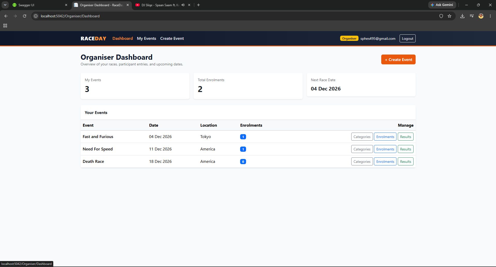
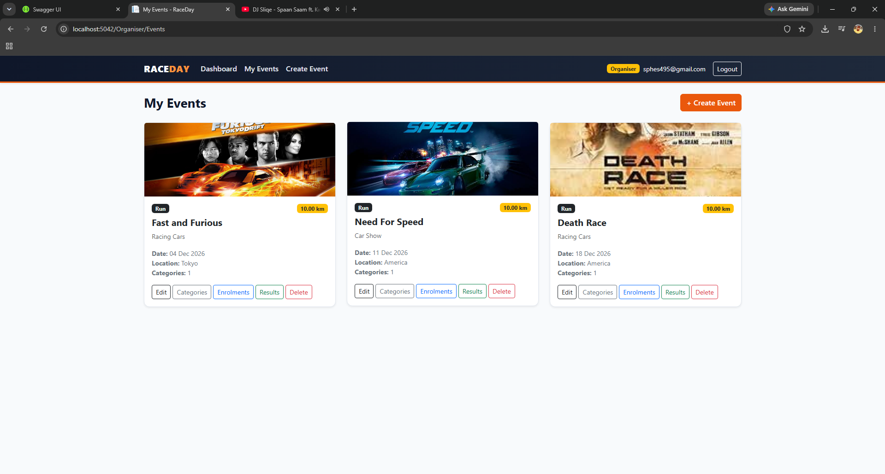
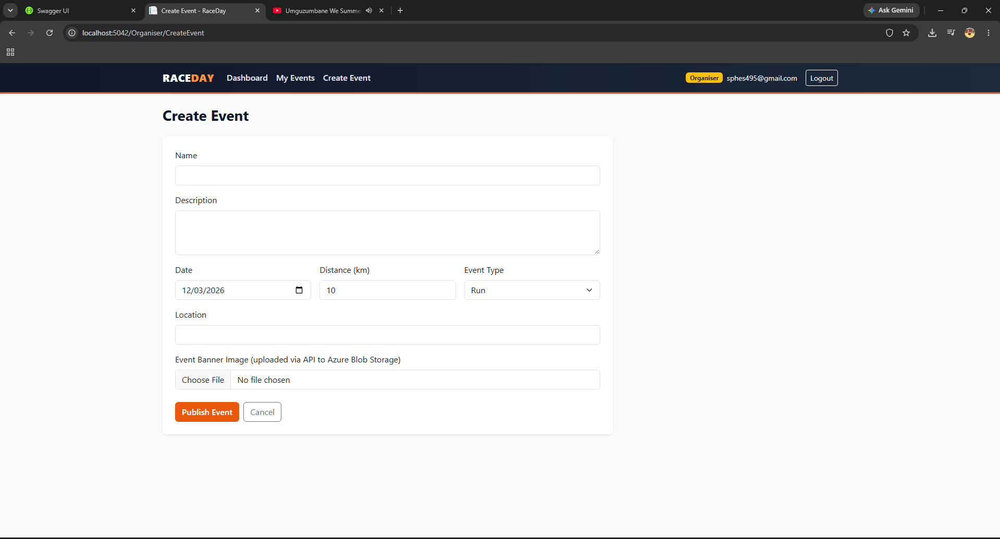
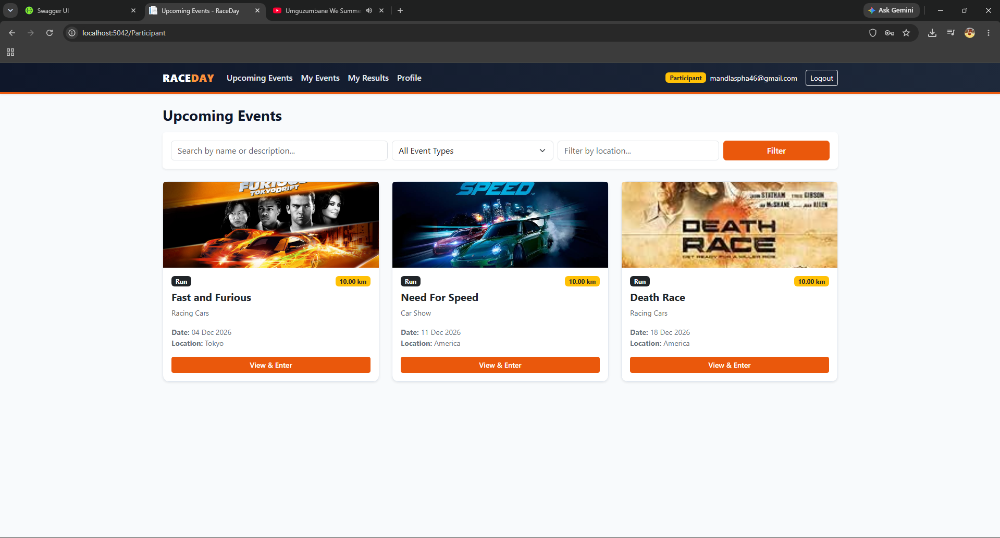
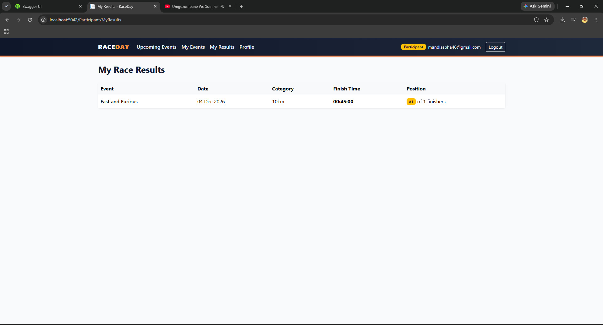
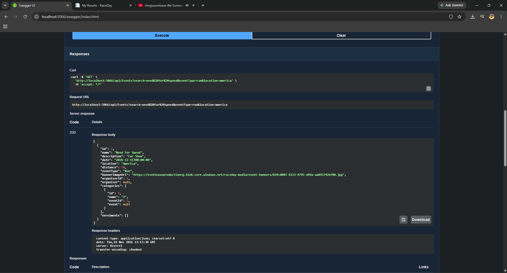
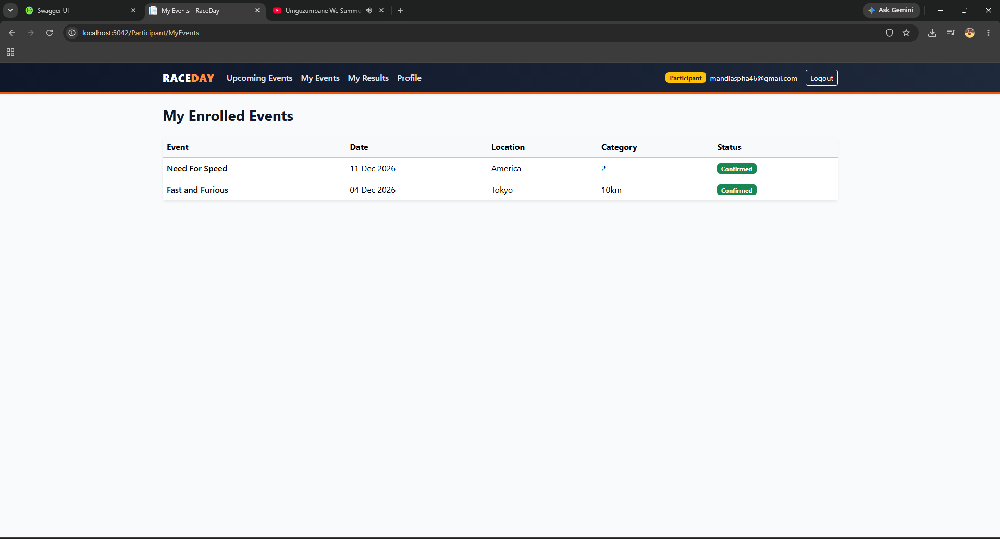

RaceDay System (PROG6212) – POE Submission
1. Project Overview
RaceDaySystem is a .NET 10.0 sporting-event management platform built using an API-first architecture. It supports the management of sporting events, event categories, participant enrolments, and race results.
The solution contains three main application components:
`RaceDay` – ASP.NET Core RESTful API: Provides backend functionality for authentication, events, categories, enrolments, and race results. It uses Entity Framework Core with SQL Server and integrates with Azure Blob Storage for event banner images.
`RaceDay.Mvc` – ASP.NET Core MVC web application: Provides the browser-based interface used by Organisers and Participants. The MVC application communicates with the REST API.
`RaceDay.Tests` – xUnit test project: Contains automated tests for core application behaviour and validation.
The repository also includes Docker configuration and a GitHub Actions workflow for automated build and test tasks.

2. Main Features
2.1 Organiser Features
Organisers can:
View an organiser dashboard showing event totals, enrolment totals, and the next race date.
Create and publish sporting events.
Enter event details such as name, description, date, distance, event type, and location.
Upload an event banner image. The image is sent through the API and stored using Azure Blob Storage.
View and manage events they have created.
Edit or delete events.
Configure event categories.
View participant enrolments for an event.
Record participant finishing times and race positions.
2.2 Participant Features
Participants can:
Register an account and log in.
Browse upcoming sporting events.
Search and filter events by name or description, event type, and location.
View event information, including its date, location, type, distance, and categories.
Enrol in an event category.
View their enrolled events and enrolment status.
View their published race results, including finishing time and position.
Access their profile and log out.
2.3 Authentication and Authorisation
The application provides separate Organiser and Participant workflows. Access to the relevant pages and operations is controlled according to the authenticated user's role.

3. Technologies and Tools
Technology / Tool	Purpose
.NET 10.0	Application platform and runtime
ASP.NET Core Web API	RESTful backend services
ASP.NET Core MVC	Browser-based user interface
C#	Application programming language
Entity Framework Core	Object-relational mapping and database migrations
SQL Server	Relational database
Azure Blob Storage	Storage for event banner images
Swagger / OpenAPI	API documentation and endpoint testing
xUnit	Automated unit testing
Docker	Application containerisation
Docker Compose	Running the application services together
GitHub Actions	Automated build, test, and Docker image workflow
Visual Studio	Development and testing environment

4. Solution Structure
The repository contains the following main projects and configuration locations:
```text
RaceDaySystem/
├── RaceDay/                       # ASP.NET Core REST API
│   ├── Migrations/                # Entity Framework Core migrations
│   ├── Dockerfile                 # API container build instructions
│   └── appsettings.json           # Application configuration
├── RaceDay.Mvc/                   # ASP.NET Core MVC front-end
│   └── Dockerfile                 # MVC container build instructions
├── RaceDay.Tests/                 # xUnit automated tests
├── .github/
│   └── workflows/
│       └── ci.yml                 # GitHub Actions CI workflow
├── docker-compose.yml             # Multi-container configuration
└── RaceDaySystem.slnx             # .NET solution
```
The exact contents of each project may include additional controllers, models, views, services, configuration files, and supporting classes.
5. Prerequisites
Install the following before running the application locally:
.NET 10.0 SDK
SQL Server (local SQL Server or another accessible SQL Server instance)
Git
Visual Studio or a compatible code editor
Docker Desktop, if you intend to use the containerised setup
An Azure Storage account and Blob Storage connection string for event banner uploads
Check that the .NET SDK is installed by running:
```bash
dotnet --version
```

5. Setup and Run – Local Development
Step 1: Clone the Repository
Open PowerShell or a terminal and run:
```bash
git clone https://github.com/10452327/RaceDaySystem.git
cd RaceDaySystem
```
Step 2: Configure the Database Connection
Open `RaceDay/appsettings.json` and check the `ConnectionStrings:DefaultConnection` setting.
Update the connection string so that it points to the SQL Server instance available in your development environment. Do not commit real passwords or other private credentials to GitHub.
Step 3: Configure Azure Blob Storage
The API uses Azure Blob Storage for event banner images. Configure the storage connection string using .NET User Secrets.
Run the following command once if User Secrets has not already been initialised for the API project:
```bash
dotnet user-secrets init --project RaceDay
```
Add your Azure Blob Storage connection string:
```bash
dotnet user-secrets set --project RaceDay "AzureBlobStorage:ConnectionString" "<YOUR_AZURE_BLOB_CONNECTION_STRING>"
```
Replace the placeholder with your own Azure Storage connection string. Keep this value private and do not publish it in the repository.
Step 4: Install Entity Framework Core Tools
If the Entity Framework Core command-line tool is not installed, run:
```bash
dotnet tool install --global dotnet-ef
```
If it is already installed, update it when necessary:
```bash
dotnet tool update --global dotnet-ef
```
Step 5: Create or Update the Database
From the repository root, apply the Entity Framework Core migrations:
```bash
dotnet ef database update --project RaceDay
```
The migration files and model snapshot are maintained in the `RaceDay/Migrations` directory.
Step 6: Run the REST API
Open a terminal at the repository root and run:
```bash
dotnet run --project RaceDay
```
The API is configured for local development at:
```text
http://localhost:5066
```
Step 7: Open Swagger
Open the following address in a browser:
http://localhost:5066/swagger/index.html
Swagger provides an interactive interface for viewing the available API operations and submitting requests.
Step 8: Run the MVC Front-End
Open a second terminal at the repository root and run:
```bash
dotnet run --project RaceDay.Mvc --urls "http://localhost:5042"
```
Open the web application at:
http://localhost:5042
The MVC front-end uses the REST API for application operations. Ensure that the API is running and that the MVC application's API configuration points to the correct API address.

6. Application Walkthrough and Screenshots
The screenshots below show the application interfaces and an example API request captured during testing.
6.1 Organiser Dashboard
The Organiser Dashboard provides an overview of the organiser's events, total participant enrolments, and the next scheduled race date. It also displays an event table with links to manage categories, enrolments, and results.

Figure 1: Organiser Dashboard showing event and enrolment summaries and event-management actions.
6.2 Organiser – My Events
The My Events page displays the events created by the organiser as event cards. Each card displays the event banner, event type, distance, date, location, and available management actions. Organisers can edit events, manage categories, view enrolments and results, or delete an event.

Figure 2: Organiser My Events page displaying the created sporting events and management options.
6.3 Organiser – Create Event
The Create Event page allows an organiser to enter an event name and description, select a date and event type, provide a distance and location, and select a banner image for upload. The banner is uploaded through the API to Azure Blob Storage.

Figure 3: Create Event form with event details and banner image upload.
6.4 Participant – Upcoming Events
Participants can browse the available events on the Upcoming Events page. Search and filter controls allow participants to narrow the displayed events by name or description, event type, and location. Each event card provides a View & Enter option.

Figure 4: Participant Upcoming Events page showing event cards and search and filter controls.
6.5 Participant – My Race Results
The My Race Results page displays the participant's published race results. The results table includes the event name, event date, category, finishing time, and finishing position.

Figure 5: Participant My Race Results page displaying a recorded finishing time and position.
6.6 Swagger – API Search Response
The Swagger screenshot demonstrates an event search request using query parameters for the search term, event type, and location. The displayed request returns HTTP 200, and the response body contains event information, including the event name, description, date, location, distance, event type, banner image URL, categories, and enrolments.

Figure 6: Swagger showing an event search request and a successful HTTP 200 response.
6.7 Participant – My Enrolled Events
The My Enrolled Events page displays the participant's event entries. The table includes the event, date, location, selected category, and enrolment status.

Figure 7: Participant My Enrolled Events page showing enrolled events and their confirmation statuses.

7. REST API Documentation
The backend exposes RESTful endpoints for the system's main functions, including:
Authentication and account access
Sporting event management
Event categories
Participant enrolments
Race results
The interactive API documentation is available through Swagger when the API is running:
http://localhost:5066/swagger/index.html
Swagger can be used to inspect endpoint methods, review request parameters and response schemas, and execute API requests. The screenshot in Figure 6 provides an example of an event search request returning a successful response.

8. Docker and Docker Compose
The solution includes Dockerfiles for the API and MVC projects, as well as a `docker-compose.yml` file for running the application services together.
From the solution root, build and start the configured containers in detached mode:
```bash
docker compose up --build -d
```
The documented service addresses are:
Service	Local address
RaceDay API	`http://localhost:5066`
RaceDay MVC	`http://localhost:5067`
The API and MVC containers use container port `8080`, mapped to their respective host ports in the Docker Compose configuration. These Docker addresses are separate from the local development MVC address (`http://localhost:5042`) used in Section 6.
To view the running containers:
```bash
docker compose ps
```
To view service logs:
```bash
docker compose logs
```
To stop the Compose services:
```bash
docker compose down
```
Database persistence and environment-variable configuration depend on the settings defined in `docker-compose.yml`. Configure required secrets and connection strings before starting the containers.

9. Continuous Integration and Continuous Delivery (CI/CD)
The project uses GitHub Actions to automate build and test tasks. The workflow configuration is stored at:
```text
.github/workflows/ci.yml
```
The workflow is configured to run for pushes and pull requests targeting the `main` and `master` branches.
The documented workflow performs the following tasks:
Checks out the repository.
Sets up the .NET 10.0 SDK.
Restores the solution dependencies.
Builds `RaceDaySystem.slnx` using the Release configuration.
Runs the automated tests in `RaceDay.Tests/RaceDay.Tests.csproj`.
Builds the Docker image for the RaceDay API.
Builds the Docker image for the RaceDay MVC application.
The workflow builds the images using the project Dockerfiles and labels them `raceday-api:latest` and `raceday-mvc:latest`.
A previous submission screenshot showed the `build-and-test` job completing successfully. The later documented workflow is described as the `build-test-docker` job.
View the GitHub Actions workflow run

10. Unit Testing
The solution includes the `RaceDay.Tests` project, which uses xUnit for automated testing.
The tests are intended to verify core application behaviour, including participant registration, authentication, and input validation.
Run the tests from the repository root:
```bash
dotnet test RaceDay.Tests/RaceDay.Tests.csproj --configuration Release --verbosity normal
```
Alternatively, run all tests discovered in the solution:
```bash
dotnet test
```
The earlier Visual Studio Test Explorer screenshot supplied for the submission recorded the following test results:
Result	Count
Total tests	3
Passed	3
Failed	0
Skipped	0
Overall status	Successful
These figures describe the test run shown in the supplied screenshot; results may differ if the test suite changes or is executed in a different environment.

11. Video Demonstration
YouTube demonstration: Watch the RaceDay System demonstration :" "
The demonstration is intended to show the application running, the Swagger interface, the main API functionality, relevant registration and authentication workflows, and automated test execution.

12. References
GitHub (n.d.) GitHub Actions documentation. Available at: https://docs.github.com/en/actions (Accessed: 19 November 2026).
Microsoft (n.d.) ASP.NET Core documentation. Available at: https://learn.microsoft.com/en-us/aspnet/core/ (Accessed: 19 November 2026).
Microsoft (n.d.) Azure Blob Storage documentation. Available at: https://learn.microsoft.com/en-us/azure/storage/blobs/ (Accessed: 19 November 2026).
Microsoft (n.d.) Entity Framework Core documentation. Available at: https://learn.microsoft.com/en-us/ef/core/ (Accessed: 19 November 2026).
xUnit (n.d.) xUnit.net documentation. Available at: https://xunit.net/ (Accessed: 19 November 2026).

13. AI Disclosure
AI assistants, including GitHub Copilot, were used as collaborative support for tasks such as code structuring, debugging, developing test ideas, configuring containers and CI/CD, and preparing documentation. The project authors remain responsible for reviewing the implementation and ensuring that the submitted code, configurations, test results, and documentation accurately represent the completed system.
